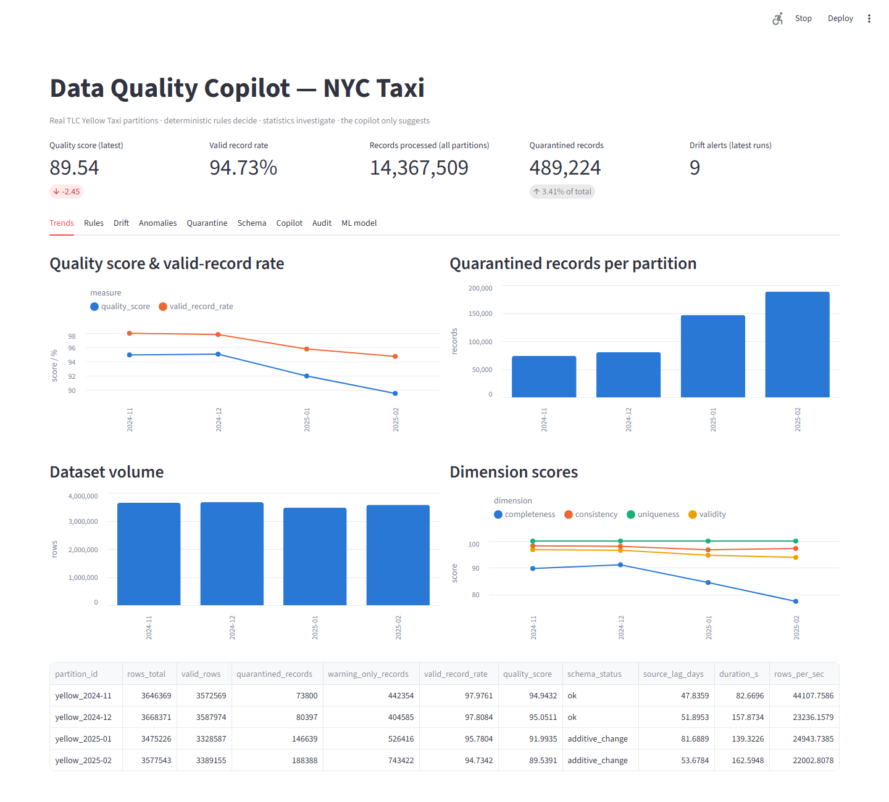
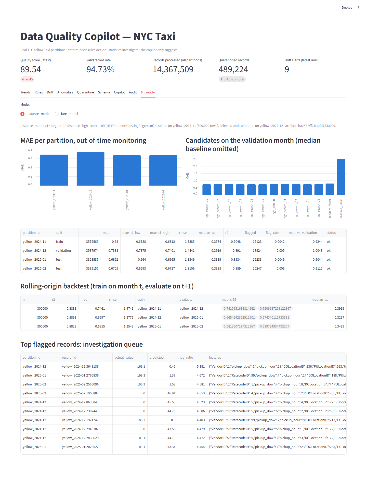
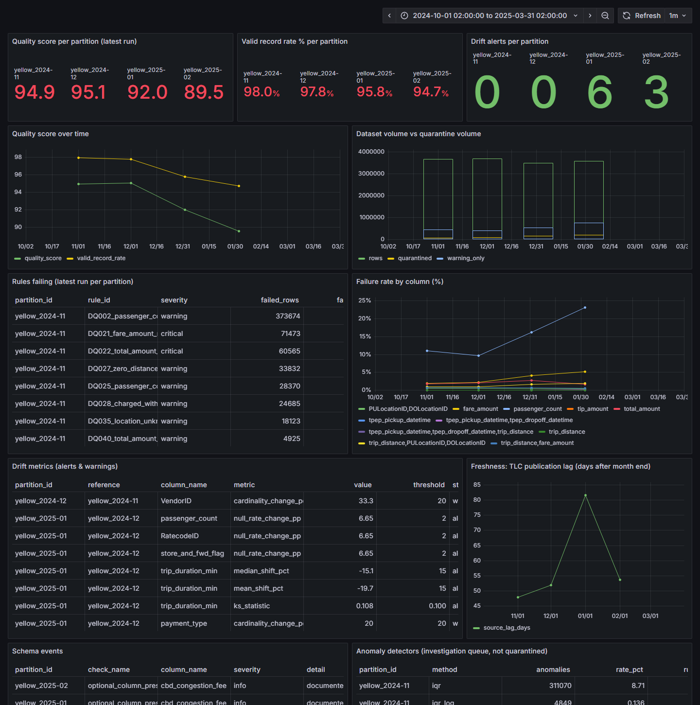
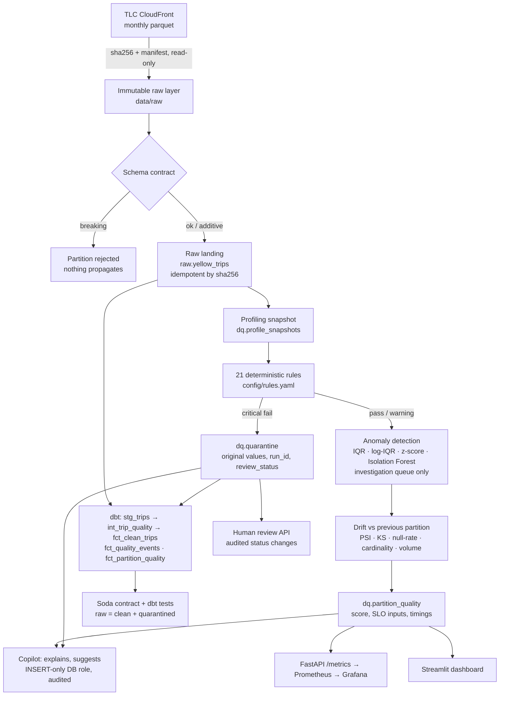

# Data Quality Copilot — NYC Taxi

**A data-quality platform that stops unreliable records before they reach analytics — built and measured on 14,367,509 real NYC taxi trips.**

## In 30 seconds

- **What it does:** ingests four months of official TLC trip data into an immutable, hash-verified raw layer; checks every record against a schema contract and 23 versioned rules; **quarantines** failures (never deletes them); detects drift and anomalies; uses two supervised ML models as a second line of defence; exposes everything through an API, Prometheus/Grafana and a dashboard.
- **What it found:** 489,224 records quarantined (3.41%), **0 silently lost** (verified by dbt on every build), 1 real schema change (the January 2025 congestion fee), 9 drift alerts (trip duration −19.7% after congestion pricing), and a data-quality regression large enough to **breach the SLO in January and February 2025** — reported, not hidden.
- **Rules vs ML, measured:** on 4,363 labelled errors, rules + the fare model reach precision **0.96** / recall **0.75**; Isolation Forest alone reaches 0.10 / 0.05. On real data, **38 of 40** manually reviewed model flags are genuine issues — and reviewing them led to **two new rules**.
- **Honest by design:** every number is regenerated by one script (`scripts/reproduce.sh`); what did not work is documented in [*What Failed and What I Changed*](#what-failed-and-what-i-changed).
- **Stack:** Python · Polars · PostgreSQL · dbt · Soda · Prefect · scikit-learn · FastAPI · Prometheus · Grafana · Streamlit · Docker · pytest · GitHub Actions.

<table>
  <tr>
    <td width="50%"></td>
    <td width="50%"></td>
  </tr>
  <tr>
    <td><sub>Quality dashboard: score and valid-record rate falling over four months, quarantine growing.</sub></td>
    <td><sub>ML tab: out-of-time error per month, 14 candidates compared, rolling-origin backtest, flagged records.</sub></td>
  </tr>
  <tr>
    <td colspan="2"></td>
  </tr>
  <tr>
    <td colspan="2"><sub>Grafana (provisioned as code): per-partition quality, failing rules, failure rate by column, drift alerts, freshness, schema events, detector volumes.</sub></td>
  </tr>
</table>

All numbers in this README are read from `reports/results.md`, which `scripts/reproduce.sh` regenerates from scratch (raw files → wiped warehouse → pipeline → rerun → dbt → Soda → failure demo → benchmark → report). End-to-end processing of the 14.4M rows: 493 s (29,154 rows/s) on a 16-logical-core / 16 GB Windows machine (Docker Desktop).

---

## What this project demonstrates

| Role | What to look at |
|---|---|
| **Data Engineering** | immutable hash-verified raw layer, schema contract, idempotent loads, quarantine with audit trail, dbt models + tests, Soda contract, Prefect flow, Docker, Prometheus/Grafana, CI quality gate, one-command reproduction |
| **Data Science** | rules grounded in measured data, drift statistics (PSI, KS), two supervised models with out-of-time validation, baselines, a seeded hyper-parameter search, a second model family, a pre-declared selection rule, rolling-origin backtest, confidence intervals, feature importance, segment error analysis, a labelled benchmark comparing eight detectors with operating curves, three manual false-positive reviews, documented negative results |
| **ML Engineering** | versioned model registry with data and artifact hashes, deterministic retraining, leakage guard enforced by tests, model serving endpoint, per-partition performance monitoring and a degradation alert, model card ([docs/MODEL_CARD.md](docs/MODEL_CARD.md)) |

---

## Business Question

> How can a data team automatically detect, isolate, explain and monitor data-quality problems **before** unreliable records reach downstream analytical systems?

## Problem

Monthly TLC trip files are large (3.5M rows each), chronological and produced by several vendors' meters. Across partitions they contain schema changes, missing values, impossible numbers, accounting reversals, out-of-period timestamps, distribution changes and vendor-specific conventions. If nothing stops them, a revenue dashboard silently averages negative fares, a duration model learns from trips that end before they start, and nobody notices that a new column appeared.

## Objective

A platform that ingests multiple real periods, profiles them, applies explicit versioned rules, detects statistical anomalies and drift, quarantines (never deletes) failing records, keeps a full audit trail and quality history, exposes monitoring, and uses an LLM **only** to explain what deterministic checks already found.

## Solution



| Layer | Tech | Where |
|---|---|---|
| Ingestion (immutable, hash-verified, idempotent) | Python, pyarrow | `src/dqc/ingest.py` |
| Schema contract + schema diff vs previous partition | Polars | `src/dqc/schema.py` |
| Profiling | Polars | `src/dqc/profiling.py` |
| Rule engine (YAML → Polars expressions) | Polars | `src/dqc/rules.py`, `config/rules.yaml` |
| Anomaly detection | NumPy, scikit-learn | `src/dqc/anomaly.py` |
| Supervised residual models: expected fare, expected distance (search, selection, registry, backtest, scoring, review) | scikit-learn, joblib | `src/dqc/ml/` |
| Drift | SciPy, NumPy | `src/dqc/drift.py` |
| Warehouse, quarantine, audit | PostgreSQL 16 | `infra/postgres/init.sql` |
| Modelling + tests | dbt-postgres | `dbt/` |
| Independent contract | Soda Core | `soda/` |
| Orchestration | Prefect 3 | `flows/quality_flow.py` |
| API + metrics exporter | FastAPI, prometheus-client | `api/main.py` |
| Monitoring | Prometheus (+ alert rules), Grafana (provisioned) | `infra/` |
| Dashboard | Streamlit + Altair | `dashboard/app.py` |
| Copilot | built-in deterministic analyzer (default, no API key); optional Anthropic API (`claude-opus-5-5`) | `src/dqc/copilot.py` |
| Tests / CI | pytest, GitHub Actions | `tests/`, `.github/workflows/ci.yml` |

**Evidently was not used**: PSI/KS/null-rate/cardinality are ~120 lines in `drift.py`, fully tested, and persisted in the same warehouse as everything else. Evidently's HTML reports would add a heavy dependency without adding a metric we need.

## Real Dataset

Official **NYC Taxi & Limousine Commission — TLC Trip Record Data**, Yellow Taxi, `https://d37ci6vzurychx.cloudfront.net/trip-data/yellow_tripdata_YYYY-MM.parquet`. No generated trips are used as benchmark data. Raw files are written once (atomic rename), set read-only and re-hashed on every run (`python -m dqc verify-raw`); a hash mismatch fails the run (tested).

| partition | month | format | rows | size | columns | sha256 (prefix) | downloaded | source Last-Modified |
|---|---|---|---:|---:|---:|---|---|---|
| yellow_2024-11 | 2024-11 | parquet | 3,646,369 | 60.7 MB | 19 | `5ef321876de5007a` | 2026-09-30 | Fri, 17 Jan 2025 20:03:41 GMT |
| yellow_2024-12 | 2024-12 | parquet | 3,668,371 | 61.5 MB | 19 | `41ebf7db80bebde6` | 2026-09-30 | Fri, 21 Feb 2025 21:29:11 GMT |
| yellow_2025-01 | 2025-01 | parquet | 3,475,226 | 59.2 MB | 20 | `9af277e4c0d3f9de` | 2026-09-30 | Wed, 23 Apr 2025 16:31:58 GMT |
| yellow_2025-02 | 2025-02 | parquet | 3,577,543 | 60.3 MB | 20 | `037cba555a73663f` | 2026-09-30 | Wed, 23 Apr 2025 16:16:58 GMT |

Full hashes and per-column source schemas: `data/raw/manifest.json`. Zone reference: official `taxi_zone_lookup.csv` (265 zones). The window Nov-2024 → Feb-2025 was chosen **because** it spans a real upstream change (MTA congestion pricing started 5 Jan 2025 → new `cbd_congestion_fee` column), not to make results look good.

## Quality Framework

| dimension | measured by |
|---|---|
| completeness | DQ001 mandatory not-null, DQ002 passenger_count not-null, null-rate drift |
| validity | ranges and TLC-dictionary domains (DQ011, DQ020–DQ025, DQ030–DQ035) |
| uniqueness | DQ050 exact duplicate, DQ051 business-key duplicate |
| consistency | DQ010 pickup < dropoff, DQ012 partition window, DQ026 implied speed, DQ040 total reconciliation |
| freshness | TLC publication lag after month end (`source_lag_days`) |
| distribution stability | PSI, KS D, mean/median shift, standardised mean shift, cardinality / new-category share |
| volume stability | row-count change vs previous partition |

**Severity semantics.** `critical` → record quarantined and excluded from `fct_clean_trips`. `warning` → record stays in the curated layer with `failed_warning_rules` populated and is logged as a quality event.

**Scores (per partition).**
- `valid_record_rate = rows without critical failure / rows` (the "critical rule pass rate").
- `quality_score = 100 × (1 − (critical_failed_records + 0.25 × warning_only_records) / rows)`. Record-level on purpose: a mean of rule pass rates is ≈99.9 for any dataset and can't move.
- dimension scores = % of records passing every rule of that dimension.

## Deterministic Rules

`config/rules.yaml` — ruleset `1.4.0`, 23 rules, each with `rule_id`, `rule_version`, `severity`, `dimension`, `description`. Results per run are stored with `rule_id, rule_version, severity, records_checked, failed_rows, failure_rate, run_id, partition_id` (`dq.rule_results`); definitions are versioned in `dq.rule_definitions`. **Every threshold was checked against the TLC data dictionary or measured on the data before being written:**

| rule | severity | grounded in |
|---|---|---|
| DQ001 mandatory fields not null | critical | contract |
| DQ002 passenger_count not null | warning | measured: nulls co-occur 1:1 with `payment_type=0` (Flex Fare) and with null RatecodeID / store_and_fwd_flag / congestion_surcharge / Airport_fee → systematic reporting gap, not random loss |
| DQ010 pickup < dropoff | critical | physics |
| DQ011 duration ≤ 24 h | critical | a metered trip cannot last a day |
| DQ012 pickup inside the file's month | critical | measured: 2002/2008/2009 timestamps in 2024 files |
| DQ020 0 ≤ trip_distance ≤ 200 mi | critical | p99.99 ≈ 57 mi; max observed 398,608 mi |
| DQ021 0 ≤ fare_amount ≤ $1,000 | critical | p99.99 ≈ $300; max observed $863,372 |
| DQ022 0 ≤ total_amount ≤ $1,500 | critical | as above |
| DQ023 tip ≥ 0 | critical | — |
| DQ024 passenger_count ≤ 6 | critical | TLC rule: 4 (or 5) passengers + one child under 7 |
| DQ025 passenger_count = 0 | warning | driver-entered; trip otherwise usable |
| DQ026 implied speed ≤ 90 mph | warning | distance/clock inconsistency |
| DQ027 distance 0 on a ≥ 1 min trip between different zones | warning | **discovered by the distance model's manual review**, then measured: 0.93% → 1.00% → 1.69% → 1.95% of records per month, mostly Flex Fare; warning because the fare is real — quarantining would remove a further ~2% of trips, a data-owner decision |
| DQ028 fare charged with distance 0 and duration < 1 min | warning | **discovered by the fare model's manual review**, then measured: 0.57–0.74% per month, ~45% negotiated-rate |
| DQ030 VendorID ∈ {1,2,6,7} | critical | data dictionary (6 = Myle, 7 = Helix) |
| DQ031 payment_type ∈ {0..6} | critical | data dictionary (0 = Flex Fare) |
| DQ032 RatecodeID ∈ {1..6, 99} | critical | data dictionary (99 = unknown) |
| DQ033 store_and_fwd_flag ∈ {Y,N} | critical | data dictionary |
| DQ034 PU/DO zone ∈ official lookup | critical | replaces "plausible coordinates": lat/long were removed from TLC files after June 2016 |
| DQ035 zone 264 "Unknown" | warning | lookup (265 "Outside of NYC" is legitimate) |
| DQ040 total = Σ components ± $0.01 | warning | see *What failed* — v1 flagged 28% of rows |
| DQ050 exact duplicate | critical | first occurrence kept |
| DQ051 business-key duplicate | warning | measured: 52,531 key collisions in Jan-2025, **all** are charge + reversal pairs → excluded |

"Coordinate plausibili" could not be implemented as asked: **the columns do not exist** in 2024-25 files; zone validity against the official lookup is the equivalent control.

## Statistical Detection

Runs **after** the rules, **only on rule-valid records**, and never quarantines — it feeds an investigation queue (`dq.anomaly_results`, top-500 records per method in `dq.anomaly_records`). Features: distance, duration, fare, tip, total, tolls.

| method | notes |
|---|---|
| IQR (Tukey k=3) | zero-inflated features (Q1 = Q3, e.g. tolls) are skipped instead of flagging every non-zero value |
| log-IQR | same fences on `sign(x)·log1p(|x|)`; added after measuring that plain IQR flags every airport trip |
| z-score (\|z\| > 4) | |
| Isolation Forest | 100 trees, fit on a 200k sample, contamination 1% |

### Why anomaly detection is not a substitute for business rules

1. **It has no notion of "wrong", only of "rare".** On real rule-valid data plain IQR flags 7.9–8.9% of trips (mostly legitimate airport runs); Isolation Forest flags ~1% of *any* dataset by construction (`contamination=0.01`) — including perfectly clean data (unit-tested).
2. **It misses errors that are common or plausible-looking.** Benchmark below: Isolation Forest caught 1.4% of injected `passenger_count=9`, 1.1% of `payment_type=9`, 1.1% of `NULL` zones and 2.2% of `dropoff < pickup` — every one of these is caught at 100% by a one-line rule.
3. **It is not explainable or stable enough to quarantine on.** A record's IF score changes when the rest of the month changes; a rule verdict does not. Quarantine decisions must be reproducible and reviewable.
4. **Where it helps:** errors with *valid* values but *unusual magnitude* (fare ×10, tip spikes) that no rule can express without false positives — that is where a statistical second line earns its place.

## Machine Learning: two residual models

The unsupervised detectors above answer "is this record unusual?". A supervised model answers a sharper question: **"is this value consistent with the rest of the record?"** — which is where the plausible-looking errors live. Two models share one implementation (`src/dqc/ml/`); details in the [model card](docs/MODEL_CARD.md).

| model | predicts | from | question it answers |
|---|---|---|---|
| `fare_model` | `fare_amount` | distance, duration, rate code, vendor, payment type, passengers, hour, weekday, zones | is this fare consistent with this trip? |
| `distance_model` | `trip_distance` | duration, rate code, vendor, hour, weekday, zones | is this distance consistent with this trip? |

No model sees its own target or any monetary column, and the distance model never sees the fare, so the two detectors fail independently (enforced by a unit test).

**Protocol (chronological, no leakage)**

| split | partition | used for |
|---|---|---|
| train | 2024-11 (500k sampled rule-valid rows) | fitting every candidate |
| validation | 2024-12 | model selection, flag-threshold calibration, permutation importance |
| test | 2025-01, 2025-02 (every rule-valid row) | reported only — never used for a decision |

**Candidates and selection.** 14 candidates per model: two baselines, a random forest, a default gradient boosting and a seeded random search over 10 gradient-boosting configurations. The selection rule was fixed before looking at results: *among candidates within 1% of the best validation MAE, take the smallest serialised model* — a 1% MAE difference is irrelevant for a detector, a 60× larger artifact is a real serving cost.

Fare model (validation month; search configurations outside the tolerance are omitted, full table in `reports/results.md`):

| candidate | MAE $ | R² | size MB | within 1% of best |
|---|---:|---:|---:|---|
| random forest (different family) | 1.2645 | 0.929 | 47.59 | yes |
| **gradient boosting, search #05 — selected** | 1.2666 | 0.927 | 0.81 | yes |
| gradient boosting, search #07 | 1.2751 | 0.926 | 1.28 | yes |
| gradient boosting, search #08 | 1.2760 | 0.927 | 1.04 | yes |
| gradient boosting, search #00 | 1.2763 | 0.927 | 1.07 | yes |
| gradient boosting, default configuration | 1.3028 | 0.927 | 0.29 |  |
| linear regression baseline | 4.5126 | 0.756 | 0.00 |  |
| median baseline | 11.0810 | -0.119 | 0.00 |  |

The random forest is the most accurate by $0.002 but weighs 48 MB; the rule picks a 0.8 MB gradient boosting that is statistically indistinguishable from it. **The whole search moved MAE from 1.30 to 1.27 (−3%): the model is limited by the data (negotiated and Flex fares), not by the algorithm.**

Distance model: selected MAE 0.736 mi (R² 0.891) against 2.32 mi for the median baseline and 0.789 mi for the random forest.

**Out-of-time performance** (all rule-valid records; 95% interval on the same rows as the estimate)

Fare model:

| partition | split | MAE $ | 95% CI | median AE $ | R² | flagged |
|---|---|---:|---|---:|---:|---:|
| 2024-11 | train | 1.110 | [1.105, 1.114] | 0.36 | 0.932 | 0.47% |
| 2024-12 | validation | 1.263 | [1.258, 1.269] | 0.37 | 0.918 | 0.49% |
| 2025-01 | **test** | 1.100 | [1.095, 1.105] | 0.37 | 0.922 | 0.28% |
| 2025-02 | **test** | 1.204 | [1.200, 1.208] | 0.41 | 0.925 | 0.14% |

Distance model:

| partition | split | MAE mi | 95% CI | median AE mi | R² | flagged |
|---|---|---:|---|---:|---:|---:|
| 2024-11 | train | 0.680 | [0.679, 0.681] | 0.36 | 0.905 | 0.42% |
| 2024-12 | validation | 0.739 | [0.738, 0.740] | 0.39 | 0.891 | 0.50% |
| 2025-01 | **test** | 0.665 | [0.664, 0.667] | 0.33 | 0.893 | 0.49% |
| 2025-02 | **test** | 0.671 | [0.669, 0.672] | 0.34 | 0.889 | 0.60% |

**Rolling-origin backtest** (selected configuration refit on month *t*, evaluated on *t+1*; 300k sampled rows each) — performance does not depend on which month was used for training:

| fare model: train → evaluate | MAE $ | 95% CI | R² |
|---|---:|---|---:|
| 2024-11 → 2024-12 | 1.292 | [1.274, 1.309] | 0.924 |
| 2024-12 → 2025-01 | 1.225 | [1.209, 1.241] | 0.924 |
| 2025-01 → 2025-02 | 1.203 | [1.188, 1.218] | 0.924 |

| distance model: train → evaluate | MAE mi | 95% CI | R² |
|---|---:|---|---:|
| 2024-11 → 2024-12 | 0.746 | [0.742, 0.751] | 0.888 |
| 2024-12 → 2025-01 | 0.670 | [0.665, 0.674] | 0.889 |
| 2025-01 → 2025-02 | 0.686 | [0.681, 0.690] | 0.882 |

- **No degradation after the congestion-pricing launch**: test MAE is 0.87× and 0.95× the validation MAE for the fare model, 0.90× and 0.91× for the distance model. The monitoring alert (`MAE > 1.25×` validation) stays silent — a measured result, not an assumption.
- **Segment analysis:** Flex Fare records are 3–6× harder to price (MAE $2.93–4.96 vs $0.73–0.85 for card trips). Their fare does not follow the meter — independent evidence, from a different method, for the Flex Fare issue the rules surfaced.
- **Feature importance** (permutation, ΔMAE): fare model — duration 7.47, distance 5.58, rate code 2.58, everything else < 0.2. Distance model — duration 1.45, pickup zone 0.76, drop-off zone 0.59, hour 0.20.

**As detectors.** A record is flagged when `|ln((actual + floor) / (predicted + floor))|` exceeds the 99.5th percentile of that score on the validation month (a 0.5% review budget, fixed in advance and identical for both models). Flags only feed the investigation queue.

| detector | precision [95% CI] | recall [95% CI] | false-positive rate |
|---|---|---|---:|
| fare model | 0.88 [0.86–0.89] | 0.22 [0.21–0.23] | 0.07% |
| distance model | 0.90 [0.87–0.92] | 0.13 [0.12–0.14] | 0.03% |
| rules + fare model | 0.96 [0.95–0.97] | 0.75 [0.74–0.76] | 0.07% |
| rules + both models | 0.95 [0.94–0.95] | 0.78 [0.77–0.79] | 0.10% |
| rules + log-IQR | 0.88 [0.87–0.89] | 0.73 [0.72–0.75] | 0.22% |
| Isolation Forest | 0.10 [0.09–0.12] | 0.05 [0.04–0.05] | 0.92% |

- The fare model catches **100% of `fare ×10`** (log-IQR 43%, Isolation Forest 17%); the distance model catches **100% of distance unit errors** and 31% of `distance ×5`.
- **The review budget is a dial, not a constant.** Thresholds come from the validation month only; the benchmark shows what each budget buys:

| budget | fare model: precision | recall | FPR | `fare ×10` | `distance ×5` |
|---:|---:|---:|---:|---:|---:|
| 0.1% | 0.90 | 0.10 | 0.03% | 0.99 | 0.00 |
| 0.2% | 0.89 | 0.13 | 0.04% | 1.00 | 0.00 |
| 0.5% | 0.88 | 0.22 | 0.07% | 1.00 | 0.01 |
| 1.0% | 0.81 | 0.34 | 0.18% | 1.00 | 0.69 |
| 2.0% | 0.70 | 0.38 | 0.36% | 1.00 | 0.86 |

| budget | distance model: precision | recall | FPR | `fare ×10` | `distance ×5` |
|---:|---:|---:|---:|---:|---:|
| 0.1% | 0.97 | 0.09 | 0.01% | 0.00 | 0.00 |
| 0.2% | 0.95 | 0.09 | 0.01% | 0.00 | 0.02 |
| 0.5% | 0.90 | 0.13 | 0.03% | 0.00 | 0.31 |
| 1.0% | 0.78 | 0.19 | 0.12% | 0.00 | 0.80 |
| 2.0% | 0.55 | 0.23 | 0.41% | 0.01 | 0.95 |

  Doubling the budget from 0.5% to 1% takes `distance ×5` recall from 31% to 80% for the distance model. The budget was **not** moved after seeing this table: choosing it on the benchmark would be tuning on the test set.
- Both models are **blind** to errors that leave their relationship intact: tip spikes 0%, swapped pickup/drop-off zones 0% (the swap changes neither the expected fare nor the expected distance — it is not identifiable from a single record).

**ML engineering.** `python -m dqc ml train` writes a versioned artifact and metadata (sha256 of the raw training file, every candidate's metrics and size, the selection rule, thresholds for five budgets, backtest, library versions, artifact sha256) to `models/` and `dq.model_registry`. Training is deterministic and **idempotent**: retraining on the same raw file reproduces the artifact byte for byte and therefore does not create a new version. The registry keeps history — `fare_model` v1 (default configuration) and v2 (after the search) are both there. Loading refuses an artifact whose hash does not match. `python -m dqc ml score` writes per-partition performance to `dq.model_metrics` and the top flags to `dq.model_flags`. Serving: `POST /predict/fare`, `GET /model`.

## Drift Detection

Each partition is compared with the previous one (`dq.drift_results`, history kept per run), thresholds in `config/thresholds.yaml`:

| metric | alert threshold | note |
|---|---|---|
| PSI (numeric: 10 reference-quantile bins; categorical: category frequencies) | 0.25 (warn 0.10) | |
| KS **D statistic** | 0.10 | p-values are stored but not used: on 200k-row samples every p-value is ≈0 |
| mean / median shift % | 15% | marked `n/a` when the reference mean ≈ 0 relative to its std (bug found by a unit test) |
| standardised mean shift \|Δμ\|/σ | 0.20 | |
| null-rate change | 2 pp | |
| cardinality change | 20% | downgraded to *warn* when the new categories hold < 0.1% of rows |
| volume change | 20% | |

## Quarantine

`dq.quarantine`: one row per (record, failed critical rule) with `record_id` (= `partition:row-number-in-source-file`, lineage back to the raw file), `partition_id`, `failed_rule`, `rule_version`, `severity`, `original_value` (e.g. `fare_amount=-12.8`), `reason`, full `original_record` (JSONB), `pipeline_run_id`, `quarantined_at`, `review_status` (`pending | confirmed_invalid | false_positive | fixed_upstream`).

- **Never deleted.** Reruns upsert on `(record_id, failed_rule)`; a record that stops failing (fixed upstream) is marked `resolved_by_run_id`, not removed (tested).
- **Human review** via `PATCH /quarantine/{id}/review` changes only the status and writes `dq.quarantine_review_log`. It never republishes a record: republishing requires a corrected upstream file → new sha256 → rerun.
- **No silent loss**, asserted by dbt on every build: `raw = fct_clean_trips + unresolved quarantine`, per partition.

## Copilot

Runs only after detection. `python -m dqc copilot` / `POST /copilot/explain`:

1. picks the highest-impact incidents from `dq.*` (failed rows × severity × week-on-week jump; drift by distance above threshold),
2. builds an **evidence** JSON from warehouse facts only (rule definition, counts, previous-partition rate, 8 quarantined samples, vendor × payment breakdown),
3. produces `summary, likely_causes, investigation_steps, remediation_suggestion, candidate_rule, confidence` with one of two providers: the **built-in deterministic analyzer** (default — no API key, no network, fully reproducible) or, only if `ANTHROPIC_API_KEY` is set, `claude-opus-5-5` with a JSON-schema-constrained output,
4. stores it in `dq.copilot_suggestions` with the evidence, its sha256, provider, model, prompt version, label **"SUGGESTION — not verified, requires human review"** and `status='proposed'`.

It **cannot** change data by construction, not by prompt: it writes through the Postgres role `dqc_copilot`, which has `INSERT` on `dq.copilot_suggestions` and nothing else (no `UPDATE` on quarantine, no access to `raw`/`analytics` — tested). Accepting a suggestion (`PATCH /copilot/suggestions/{id}`) records a decision; a rule change still goes through a PR, a version bump and the CI gate.

**The project needs no API key.** The built-in analyzer computes its explanation from the evidence: which (VendorID, payment_type) segment concentrates the failures and at what in-segment rate, whether the segment fails systematically (≈100%), the trend across partitions, which segment drives the change versus the previous partition, and — for drift — which payment-type share moved and which schema events happened in the same month. When one segment holds ≥ 50% of the failures at an in-segment rate ≥ 30% it proposes a candidate rule in YAML (explicitly marked as not implemented). Real output on the Feb-2025 incident (`reports/copilot_suggestions.json`):

> DQ021_fare_amount_range (v1, critical) failed 182,661 of 3,577,543 records (5.106%) in yellow_2025-02. Trend: 1.960% -> 2.139% -> 4.147% -> 5.106%.
> - 70.0% of the failures come from VendorID=2 / payment_type=0 (Flex Fare): 127,878 of its 695,049 records fail (18.4%, 3.6x the partition-wide rate).
> - 100.0% of that segment's failing records still have a non-negative total_amount: fare_amount looks like an adjustment component there, not a reversed trip (hypothesis for the source owner).
> - Remediation: keep the records quarantined until the source owner confirms; do not relax the rule to meet the SLO.

It covers the incident shapes it was written for (segment concentration, trend, share shifts); it does not reason about novel situations — that is what the optional LLM provider is for. The LLM path is implemented but was **never executed** in this build (no API key), so its output quality is not evaluated here.

## Results

See [`reports/results.md`](reports/results.md) for every table. Reference run (full, from a wiped warehouse):

| partition | rows | quarantined | % | warning-only (kept) | valid % | quality score | schema vs contract | duration s | rows/s |
|---|---:|---:|---:|---:|---:|---:|---|---:|---:|
| yellow_2024-11 | 3,646,369 | 73,800 | 2.02 | 442,354 | 97.98 | 94.94 | ok | 95 | 38,202 |
| yellow_2024-12 | 3,668,371 | 80,397 | 2.19 | 404,585 | 97.81 | 95.05 | ok | 86 | 42,630 |
| yellow_2025-01 | 3,475,226 | 146,639 | 4.22 | 526,416 | 95.78 | 91.99 | additive_change | 108 | 32,088 |
| yellow_2025-02 | 3,577,543 | 188,388 | 5.27 | 743,422 | 94.73 | 89.54 | additive_change | 203 | 17,622 |
| **total** | **14,367,509** | **489,224** | **3.41** | 2,116,777 | | | | **493** | **29,154** |

- Schema changes detected between consecutive partitions: **1** (unexpected / breaking: 0). Drift: **9 alerts**, 2 warnings.
- Stage times (s, reference run): raw landing 41–122 · rules 7–9 · persisting quality results 12–42 · anomaly detection 19–23 · profiling 2–3 · drift 3–7. Wall-clock times on this shared Docker Desktop host vary by up to ~2× between runs (four full reproductions took 780 s, 508 s, 659 s and 493 s for the same reference run); the counts and scores are bit-for-bit identical.
- **Rerun on identical inputs**: identical scores and quarantine counts for all four partitions, raw landing skipped by sha256 (4–10 s instead of 41–122 s), 0 duplicated raw rows, 0 new quarantine rows (`reports/results.md` → *Rerun check*).
- Quarantine table: 737,524 (record, rule) rows for 489,224 records, 1.08 GB including indexes and the JSONB original records.

**Reading the numbers**

- **Quality degrades over time, and the platform shows it**: valid-record rate 97.98% → 97.81% → 95.78% → **94.73%**. The driver is DQ021 (negative `fare_amount`): 71k → 78k → 144k → 183k. Breakdown of the quarantined records: Flex Fare (`payment_type=0`, VendorID 2) negative fares go 11,390 → 9,706 → 84,822 → **127,878**, while their `total_amount` stays positive. That looks like a change in how Flex Fare is reported (the fare field carrying an adjustment against the up-front price) rather than garbage — but it is a hypothesis for the source owner, so the rule was **not** loosened to make the SLO pass.
- **Schema**: 1 change detected between consecutive partitions — `cbd_congestion_fee` (double) added in 2025-01. It is a documented, additive change → accepted by the contract (`optional_columns`), 0 unexpected/breaking changes.
- **Drift (9 alerts, 2 warnings)**: Jan-2025 mean trip duration −19.7% vs Dec (median −15.1%, KS D = 0.108) — consistent with the congestion-pricing launch on 5 Jan 2025; `passenger_count`/`RatecodeID`/`store_and_fwd_flag` null rates +6.6 pp (Jan) and +7.0 pp (Feb) — the growing Flex Fare share. Warnings only: VendorID cardinality 3 → 4 in Dec (vendor 7 appears, < 0.1% of rows) and one `payment_type=5` record in Jan.
- **Duplicates**: 0 exact duplicates and 0 non-reversal business-key duplicates in 14.4M real rows. Both rules still fire correctly on the controlled fixtures.
- **Reconciliation (DQ040, warning)**: 0.15–1.07% after v3 — the 1.07% spike in Jan-2025 is VendorID 2 reporting a `cbd_congestion_fee` that is not included in `total_amount` in the fee's launch month.
- **Distance not captured (DQ027, warning, new)**: 33,832 → 36,728 → 58,735 → 69,752 trips per month (0.93% → 1.95%) between different zones with a recorded distance of 0 — it doubles in four months, the same trajectory as the Flex Fare issue. The rule exists because the distance model surfaced the pattern in its manual review. Adding it (and DQ028) lowered every quality score by ~0.2 points and moved 2025-01 below its score SLO (92.20 → 91.99): a check that sees a previously invisible problem *should* lower the score, so the threshold was not touched.

## False Positive Analysis

**1. Benchmark on injected errors** (`python -m dqc benchmark`, seed 42). 200,000 real Jan-2025 records that pass every rule + 4,363 labelled corruptions (13 types; *rule-detectable* = violates a contract, *plausible* = valid values, wrong content):

| detector | precision [95% CI] | recall [95% CI] | false-positive rate | flagged | runtime s (204k rows) |
|---|---|---|---:|---:|---:|
| rules_critical | 1.00 [1.00–1.00] | 0.67 [0.66–0.68] | 0.00% | 2,914 | 0.705 |
| rules_critical_plus_warning | 1.00 [1.00–1.00] | 0.68 [0.66–0.69] | 0.00% | 2,952 | 0.705 |
| iqr | 0.08 [0.07–0.08] | 0.35 [0.34–0.37] | 9.65% | 20,455 | 0.134 |
| rules_critical+iqr | 0.17 [0.16–0.17] | 0.87 [0.87–0.88] | 9.65% | 22,729 |  |
| iqr_log | 0.76 [0.74–0.78] | 0.32 [0.30–0.33] | 0.22% | 1,821 | 0.147 |
| rules_critical+iqr_log | 0.88 [0.87–0.89] | 0.73 [0.72–0.75] | 0.22% | 3,636 |  |
| zscore | 0.36 [0.34–0.38] | 0.20 [0.19–0.21] | 0.80% | 2,453 | 0.014 |
| rules_critical+zscore | 0.69 [0.67–0.70] | 0.79 [0.78–0.80] | 0.80% | 4,998 |  |
| isolation_forest | 0.10 [0.09–0.12] | 0.05 [0.04–0.05] | 0.92% | 2,003 | 1.745 |
| rules_critical+isolation_forest | 0.63 [0.61–0.64] | 0.70 [0.68–0.71] | 0.92% | 4,838 |  |
| fare_model | 0.88 [0.86–0.89] | 0.22 [0.21–0.23] | 0.07% | 1,094 | 0.179 |
| rules_critical+fare_model | 0.96 [0.95–0.97] | 0.75 [0.74–0.76] | 0.07% | 3,411 |  |
| distance_model | 0.90 [0.87–0.92] | 0.13 [0.12–0.14] | 0.03% | 640 | 0.372 |
| rules_critical+distance_model | 0.98 [0.97–0.98] | 0.69 [0.68–0.71] | 0.03% | 3,094 |  |
| fare_model+distance_model | 0.87 [0.85–0.88] | 0.29 [0.27–0.30] | 0.10% | 1,442 |  |
| rules_critical+fare_model+distance_model | 0.95 [0.94–0.95] | 0.78 [0.77–0.79] | 0.10% | 3,582 |  |

Intervals: percentile bootstrap over benchmark rows (300 resamples).

Recall by error type:

| error type | family | rules (critical) | rules (+warning) | IQR | log-IQR | z-score | Isolation Forest | fare model | distance model |
|---|---|---:|---:|---:|---:|---:|---:|---:|---:|
| distance_unit_error | rule_detectable | 1.00 | 1.00 | 1.00 | 1.00 | 0.91 | 0.12 | 0.73 | 1.00 |
| distance_x5 | plausible | 0.00 | 0.10 | 0.43 | 0.12 | 0.01 | 0.04 | 0.01 | 0.31 |
| dropoff_before_pickup | rule_detectable | 1.00 | 1.00 | 0.09 | 1.00 | 0.01 | 0.02 | 0.06 | 0.26 |
| exact_duplicate | rule_detectable | 1.00 | 1.00 | 0.09 | 0.00 | 0.01 | 0.01 | 0.00 | 0.00 |
| fare_over_cap | rule_detectable | 1.00 | 1.00 | 1.00 | 1.00 | 1.00 | 1.00 | 1.00 | 0.00 |
| fare_x10 | plausible | 0.00 | 0.00 | 0.97 | 0.43 | 0.61 | 0.17 | 1.00 | 0.00 |
| invalid_payment_type | rule_detectable | 1.00 | 1.00 | 0.10 | 0.01 | 0.01 | 0.01 | 0.00 | 0.00 |
| negative_fare | rule_detectable | 1.00 | 1.00 | 0.18 | 1.00 | 0.05 | 0.01 | 0.85 | 0.00 |
| null_mandatory | rule_detectable | 1.00 | 1.00 | 0.12 | 0.00 | 0.01 | 0.01 | 0.00 | 0.00 |
| passenger_overflow | rule_detectable | 1.00 | 1.00 | 0.08 | 0.00 | 0.01 | 0.01 | 0.00 | 0.00 |
| stale_timestamp | rule_detectable | 1.00 | 1.00 | 0.10 | 0.00 | 0.01 | 0.01 | 0.00 | 0.00 |
| swapped_zones | plausible | 0.00 | 0.00 | 0.09 | 0.00 | 0.00 | 0.01 | 0.00 | 0.00 |
| tip_spike | plausible | 0.00 | 0.00 | 0.99 | 0.23 | 0.81 | 0.12 | 0.00 | 0.00 |

- Rules: **precision 1.00, recall 1.00 on every rule-detectable type**, 0.00 on every plausible type → overall recall 0.67. FPR is 0 **by construction** here (negatives were selected as rule-clean) — an upper bound, not a claim that rules never misfire; the real-data false positives of the rules are the ambiguous Flex Fare cases discussed above.
- **Why the models' precision rose with ruleset 1.4.0** (fare model 0.78 → 0.88, distance model 0.60 → 0.90): the benchmark's negatives are records that pass every rule. DQ027/DQ028 now exclude zero-distance records from that pool — records the models had been flagging and the benchmark had been counting as false positives. The models did not change (same artifacts, byte for byte); the definition of "clean" did. It is also the clearest evidence of the limitation stated above: rule-clean is not the same as correct.
- Plain IQR has the highest standalone recall (0.35) at a useless **9.7% FPR** (18,915 false alarms on 196,000 clean rows).
- **log-IQR is the best complement**: FPR 0.22%; *rules + log-IQR* = precision 0.88, recall 0.73.
- **Isolation Forest is the worst detector on this data**: precision 0.10, recall 0.05, and ~35× slower than log-IQR (2.08 s vs 0.059 s on 204k rows).
- **The supervised fare model is the best statistical detector**: precision 0.88 at a 0.07% false-positive rate; with the rules, precision 0.96 and recall 0.75. Adding the distance model raises recall to 0.78 (the highest measured at a usable precision, 0.95); the intervals of the two combinations do not overlap on either metric.
- Nothing catches **swapped PU/DO zones** (≤ 9%) or **tip spikes** beyond plain IQR's noisy 99%: a swap changes neither the expected fare nor the expected distance, so it is not identifiable from a single record.

**2. Manual inspection of real anomalies.** 40 randomly sampled (seed 11) Isolation-Forest flags on rule-valid Jan-2025 data, inspected record by record against explicit criteria — $/mile, implied speed, RatecodeID vs zones (JFK flat fare $70, Newark, Nassau/Westchester), distance/duration vs fare (`reports/anomaly_review_labels.csv`, with a note per record):

| verdict | count |
|---|---:|
| plausible legitimate (airport flat fares, Newark, out-of-city trips) | 29 |
| likely data error (0.0 mi / < 1 min trips billed $82–$250; JFK flat-fare code on a 0.6 mi Upper West Side trip) | 6 |
| undetermined (negotiated fares, very slow Vendor-1 RatecodeID 99 trips) | 5 |

→ **~73% of Isolation Forest flags are false positives** on real data. The 6 true issues suggest two candidate *rules* (zero-distance trips with fare > $X; RatecodeID 2 without a JFK endpoint) — i.e. the anomaly detector's real value was to *discover rules*, not to replace them. The labels were assigned by the project author (AI-assisted build), not an independent TLC domain expert.

**3. Manual inspection of real model flags.** Same procedure, 40 random flags per model (seed 7) from Jan-2025, a month neither model saw (`reports/fare_model_review_labels.csv`, `reports/distance_model_review_labels.csv`):

| verdict | fare model | distance model |
|---|---:|---:|
| likely data error | 22 | 38 |
| Flex Fare semantic inconsistency (real multi-mile trips whose `fare_amount` is $0.30–$10 while the total is higher) | 16 | 0 |
| plausible legitimate | 1 | 1 |
| undetermined | 1 | 1 |

- **Fare model:** the data errors are mostly records with ~0 distance and ~0 duration that still carry a fare, plus metered trips with a fare of $0 or $0.01. The one legitimate case is a disputed trip whose amounts were zeroed.
- **Distance model:** 35 of the 38 errors are the same pattern — a trip between two **different** zones lasting 13–91 minutes with a recorded distance of 0.0 mi (the fare is normal: the distance simply was not captured); the rest are trips at 440–1,040 mph. The one legitimate case is a model under-prediction.
- → **1 false positive in 40 for each model (2.5%)**, against 29 in 40 for Isolation Forest on the same month.

Caveats: 40 records per model, labelled by the author. For zero-distance, zero-duration records the fare model is right partly for the wrong reason (it predicts an average negotiated fare for an input it rarely saw). Both reviews point to the same missing **rule** — "a fare is charged but distance is 0" — which is the detectors' real contribution: they discovered a rule, they do not replace one.

## Observability

- **Prometheus** (`http://localhost:9091`) scrapes `GET /metrics` on the API. Metrics are derived at scrape time from the persisted history, so they survive restarts and reflect the warehouse, not a process: `dq_records_checked_total`, `dq_quality_failures_total{rule_id,severity}`, `dq_quarantined_records_total`, `dq_quality_run_duration_seconds`, `dq_schema_failures_total`, `dq_drift_alerts_total`, `dq_quality_score`, `dq_valid_record_rate`, `dq_rule_failure_rate`, `dq_rows_per_second`, `dq_source_lag_days`, and for the model `dq_model_mae`, `dq_model_mae_vs_validation`, `dq_model_flag_rate` (labelled by model). The pipeline also exposes an in-process registry that can be pushed to a Pushgateway (`DQC_PUSHGATEWAY`).
- **Alert rules** (`infra/prometheus/alerts.yml`): valid-record rate < 95, score < 92, unexpected schema change, drift alerts, source lag > 75 d, model MAE > 1.25× validation.
- **Grafana** (`http://localhost:3001`, provisioned as code from `infra/grafana/build_dashboard.py`): per-partition quality score, valid-record rate and drift alerts, quality score over time, dataset vs quarantine volume, failing rules, failure rate by column, drift table, freshness, schema events, detectors, and a live Prometheus panel (last hour). The headline stats read the warehouse rather than Prometheus: the dashboard's time range covers the historical data months, where Prometheus has no samples.
- **Streamlit** (`http://localhost:8502`): KPIs, trends, rules, drift heat-map (status also written as text), anomalies, quarantine browser with original records, schema events, copilot suggestions, audit (runs, raw hashes, review log), ML model (selection, per-month MAE, top flags).

## Quality SLO

Targets were set after measuring the first two partitions (valid rate ≈ 97.8–98.0%, score ≈ 95.2–95.3 under ruleset 1.3.0), leaving ~3 points of headroom:

| SLO | target | 2024-11 | 2024-12 | 2025-01 | 2025-02 |
|---|---|---|---|---|---|
| critical-rule pass rate (valid records) | ≥ 95% | 97.98 ✅ | 97.81 ✅ | 95.78 ✅ | **94.73 ❌** |
| quality score | ≥ 92 | 94.94 ✅ | 95.05 ✅ | **91.99 ❌** | **89.54 ❌** |
| unexpected schema changes | 0 | 0 ✅ | 0 ✅ | 0 ✅ | 0 ✅ |
| source freshness (TLC publication lag) | ≤ 75 days | 47.8 ✅ | 51.9 ✅ | **81.7 ❌** | 53.7 ✅ |
| run duration per partition | ≤ 900 s | 95 s ✅ | 86 s ✅ | 108 s ✅ | 203 s ✅ |

Breaches are reported, not hidden: Soda's valid-rate check fails on 2025-02 and `python -m dqc gate --slo` reports four breaches — 2025-01 score 91.99, 2025-01 source lag, 2025-02 valid rate and score (logs in `reports/`). The 2025-01 freshness breach reflects the current `Last-Modified` of the TLC file (the file was re-published in April 2025), not necessarily the original publication date — a limitation of using HTTP metadata as the freshness signal. *Data age* at run time (≈ 590 days) is not an SLO: this is a deliberate historical backfill.

## Testing

`pytest` — 58 unit tests (no DB) + 5 integration tests against an isolated Postgres database (`-m db`):

| requirement | test |
|---|---|
| null / missing mandatory | `test_rules.py::test_mandatory_null`, `test_passenger_count_null_is_only_a_warning` |
| duplicates | `test_exact_duplicates_keep_first_occurrence`, `test_business_key_duplicate_excludes_reversal_pairs` |
| negative / impossible values | `test_negative_and_implausible_fare`, `test_negative_tip`, `test_accepted_values` |
| impossible trip duration / temporal | `test_impossible_trip_duration`, `test_pickup_outside_partition_month` |
| zero distance / charge without trip | `test_zero_distance_between_different_zones_is_flagged_only_for_real_trips`, `test_charge_without_a_recorded_trip` |
| invalid passenger count | `test_invalid_passenger_count` (0 → warning, 7 → critical) |
| schema drift / mismatch | `test_schema.py` (missing column, type change, unexpected column, alias, diff vs previous) |
| quarantine behaviour | `test_quarantine_rows_keep_original_values_and_never_drop_input`, `test_warning_does_not_quarantine`, `test_quarantine_keeps_original_values_and_is_resolved_not_deleted` |
| drift calculation | `test_drift_anomaly.py` (PSI, KS, null rate, cardinality, near-zero mean, rare new category) |
| duplicate ingestion / idempotent reruns | `test_ingest.py::test_ingestion_is_idempotent_and_raw_is_read_only`, `test_pipeline_db.py::test_duplicate_ingestion_and_rerun_are_idempotent` |
| raw immutability | `test_tampered_raw_file_is_detected`, `test_raw_integrity_violation_fails_the_run` |
| audit / least privilege | `test_review_is_audited_and_copilot_role_cannot_touch_data` |
| copilot (no API) | `test_copilot.py` (systematic segment + candidate rule, diffuse failures → low confidence, negative fare with positive total, null-rate drift linked to payment type) |
| ML models | `test_ml.py` (no target/monetary leakage and independence of the two models, feature matrix contract, symmetric score, selection rule = smallest artifact within 1% of best, seeded search space, confidence interval, threshold calibration, registry round-trip, idempotent retraining, tampered artifact refused, `/predict/fare`) |
| CI gate | `test_gate.py` (degraded data fails, schema regression fails, unexplained improvement fails) |

Plus dbt: 21 tests, all passing (unique/not-null/accepted values, curated contract, **no silent loss**, no quarantined record in clean) and Soda: 19 checks — 18 pass, the valid-record-rate SLO check fails on 2025-02 by design of the data, not of the code.

## CI/CD

`.github/workflows/ci.yml`:
1. **lint + unit tests**;
2. **quality gate**: a committed random sample of 50,000 **real** Jan-2025 records (`data/fixtures/ci_real_sample_yellow_2025-01.parquet`, 1.2 MB) is run through the contract + rules and compared with `ci/quality_baseline.json` (score 92.2035, valid 95.796%). The build **fails if the score drops by more than 2 points or the valid rate by more than 2 pp** — and also if the score *rises* by more than 2 points without a deliberate `--update-baseline` (a loosened or deleted rule is also a regression). `test_gate.py` proves all three cases;
3. **integration**: Postgres service, ingest one real month, DB tests, pipeline, `dbt build`, Soda, SLO gate, failure demo.

## Failure Cases

`python -m dqc demo-failures` builds six fixtures from 2,000 **real** rule-clean records (`data/fixtures/`, separate from the benchmark partitions), injects one known defect each and runs the full pipeline in an **isolated database** (`dqc_demo`):

| fixture | injected | detected by | result |
|---|---|---|---|
| schema_break | `fare_amount` removed, `trip_distance` as string | schema contract | partition rejected, **0 rows** loaded, 2 critical schema events |
| duplicate | 25 rows re-sent | DQ050 | 25 failed, 25 quarantined |
| invalid_amount | 30 negative fares + 10 × $25,000 | DQ021 | 40 / 40 |
| missing_mandatory | 20 null pickups + 15 null drop-off zones | DQ001 | 35 / 35 |
| impossible_duration | 12 drop-offs before pickup | DQ010 | 12 / 12 |
| invalid_passenger_count | 8 trips with 9 passengers | DQ024 | 8 / 8 |

## Trade-offs

- **Python rule engine as the source of truth, dbt for modelling/tests, Soda as an independent contract.** Rules in Polars run in ~15 s per 3.5M rows and emit per-record verdicts with original values; implementing them only as dbt tests would give counts, not a quarantine. dbt and Soda re-assert the result from a different engine (defense in depth).
- **Quarantine granularity = (record, rule)**, JSONB original record. Costs storage (1.08 GB for 737,524 quarantine rows) but makes every decision reviewable without going back to the parquet.
- **Warnings don't quarantine.** Quarantining `passenger_count IS NULL` would remove 10–23% of trips whose fares are fine.
- **Drift on the input (pre-rules) distribution.** Rule failures that surge (e.g. negative fares) show up in drift too — intentional: drift is about what upstream sends.
- **Record-level quality score** (sensitive, interpretable) over mean rule pass rate (always ≈ 99.9).
- **Raw landing in Postgres** (41–122 s/partition, the slowest stage) buys SQL lineage from any curated row back to the source row; a lakehouse (DuckDB/Iceberg) would be faster.
- **Isolation Forest kept** in the pipeline despite poor results — as a measured baseline that justifies the choice of log-IQR and of the supervised model, not as a control.
- **Models outside the gating path.** They are trained and scored after the pipeline (`dqc ml …`) and never quarantine: a detector whose flag rate is a quantile cannot be a contract.
- **Smallest model within 1% of the best** instead of the best: the random forest wins the fare task by $0.002 at 60× the artifact size.
- **Fixed 0.5% review budget for both models** instead of a per-model optimum picked on the benchmark.

## What Failed and What I Changed

| what failed | evidence | change |
|---|---|---|
| Fare-model score `|fare − predicted| / predicted` | bounded by 1 when the fare is too low: recall 0.00 on distance ×5 | symmetric log-ratio score; that alone reached only 0.02–0.06 → a dedicated distance model (0.33 at the fixed budget, 0.79 at 1%) |
| Zone-pair median distance as a reference | caught 97% of unit errors but 7% of distance ×5: distance between two zones varies too much | supervised distance model conditioned on duration, hour and rate code |
| Picking the lowest validation MAE | selected a 47.6 MB random forest that wins by $0.002 | pre-declared rule: smallest artifact within 1% of the best |
| Confidence interval on a subsample, point estimate on all rows | one estimate fell outside its own interval | interval and estimate computed on the same rows |
| Naive `total_amount = Σ components` rule (v1) | flagged **28%** of Nov-2024 rows | measured that VendorID 1 embeds congestion/airport fees in `extra` → v2 |
| v2 of the same rule | flagged **15%** of Jan-2025 rows | VendorID 1 also embeds the new `cbd_congestion_fee` → v3, surcharge-embedding accepted only for the vendors that do it; 1.07% remains (real VendorID-2 inconsistency) |
| "Duplicate trips" on business key | 52,531 groups in Jan-2025 | all are charge + reversal pairs → excluded; real non-reversal duplicates: 0 |
| Plain IQR | 10.8% of valid rows flagged, 263k of them because `tolls_amount` has Q1 = Q3 = 0 | skip zero-IQR features; add log-IQR (0.12–0.21% flagged) |
| Mean-shift % drift | unit test: exploded on a near-zero reference mean | guard + standardised mean shift |
| Cardinality drift | alert fired for **one** record with `payment_type=5` | new-category share metric; < 0.1% → warn |
| "2 schema changes detected" | the same added column counted in two partitions | explicit schema diff vs previous partition → 1 change |
| Quarantine build | 40–50 s per partition | per-rule assembly on the failing subset → 0.5 s |
| Record flags | 34 s per partition | filter failing rows before building lists → 4 s |
| Raw load | 79 s with row-by-row index maintenance | COPY into an index-free table + `ATTACH PARTITION`; still 41–122 s — the remaining bottleneck |
| dbt `fct_clean_trips` | `No space left on device` (Docker `/dev/shm` = 64 MB) | `shm_size: 1g` |
| Soda Core | `ModuleNotFoundError: distutils` on Python 3.13 | `setuptools` shim pinned in the `soda` extra |
| Copilot template | suggested querying quarantine for *warning* rules | severity-aware investigation steps |
| Copilot prioritisation | 1-row cardinality alert ranked above 144k negative fares | priority normalised by distance from threshold |
| Host ports | 3000/9090/8501 already used on the build machine | configurable host ports (defaults 3001/9091/8502) |

## Known Limitations

- **Semantics of Flex Fare negatives are unresolved** — they drive the SLO breach and may be false positives of DQ021; needs the source owner.
- **Benchmark negatives are "rule-clean", not "verified correct"**, so rule FPR = 0 is by construction; plausible-error recall numbers depend on the chosen corruption types.
- **Manual review** covers 40 records, one method, one month, by the author.
- **Swapped zones and tip spikes** remain undetected by every method; `distance ×5` is caught 31% of the time at the fixed budget.
- **Models**: one validation month for selection (the backtest covers three month pairs but selects nothing); a 10-configuration search; two model families; intervals are for the mean error, not for individual predictions; unreliable on negotiated and Flex fares; no analysis of errors by borough. See the model card.
- **Freshness** uses HTTP `Last-Modified`, which changes on re-publication.
- **Single machine** (16 logical cores, 16 GB, Docker Desktop/WSL2). Throughput numbers are for that host; raw landing dominates.
- **Optional LLM provider never executed** (no API key in the build environment). All stored suggestions come from the built-in deterministic analyzer, which only handles the incident shapes it was coded for.
- **Only Yellow Taxi**; green/FHV have different schemas and would need their own contracts.
- `code_version` falls back to the package version when the directory is not a git repository.

## How to run

```bash
python -m venv .venv && . .venv/bin/activate   # Windows: .venv\Scripts\activate
pip install -e ".[dev,dbt,soda,dashboard,copilot,orchestration]"
docker compose up -d postgres
python -m dqc ingest 2024-11 2024-12 2025-01 2025-02
python -m dqc run
python -m dqc ml train && python -m dqc ml score   # fare + distance models: search, select, register, backtest, score
(cd dbt && dbt build --profiles-dir .)
docker compose up -d            # API :8000, Streamlit :8502, Prometheus :9091, Grafana :3001
python scripts/screenshots.py   # regenerate docs/img/*.png from the running stack (headless Edge/Chrome)
```

Everything, from scratch, including the numbers in this README: `PY=python scripts/reproduce.sh`. Orchestrated: `python flows/quality_flow.py` (Prefect). Copilot: `python -m dqc copilot` (no API key needed; set `ANTHROPIC_API_KEY` only to try the optional LLM provider).

## Final Answer

A data team can stop unreliable records **before** they reach analytics by making every step explicit and measured: an immutable, hash-verified raw layer; a schema contract that rejects breaking partitions; versioned rules grounded in the data dictionary **and in measured data**; a quarantine that keeps original values and is reconciled against raw on every build; drift and anomaly detection as a *second line* that raises questions rather than verdicts; SLOs and a CI gate that fail loudly; and an LLM confined to explaining evidence through a role that physically cannot write data. On 14.4M real TLC trips this caught a real schema change, a congestion-pricing distribution shift and a quality regression large enough to breach the SLO — and the benchmark shows why the rules, not the anomaly detector, have to be the gate.
